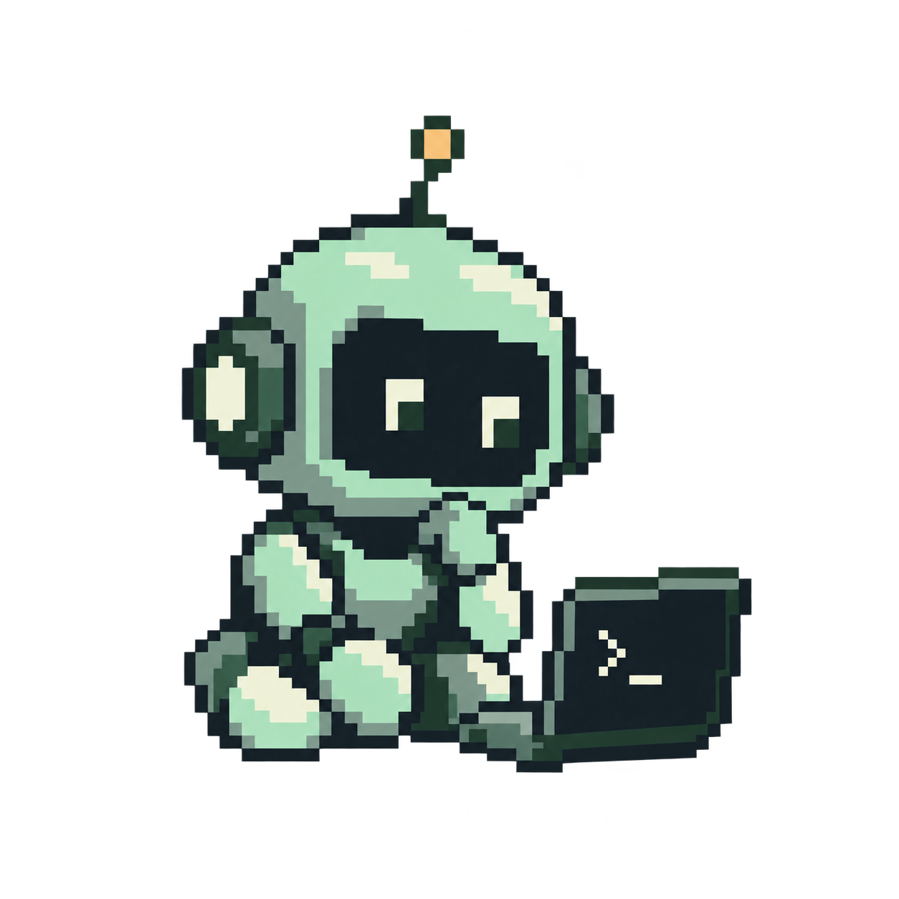
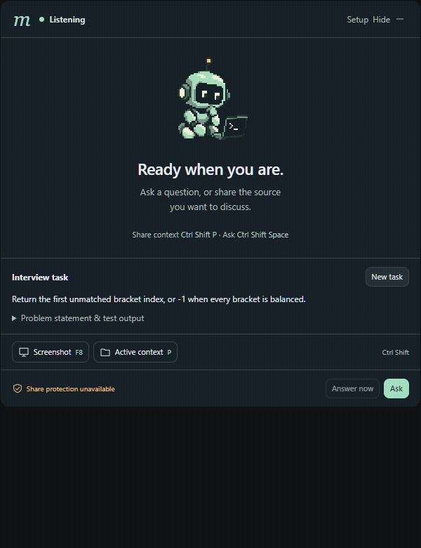
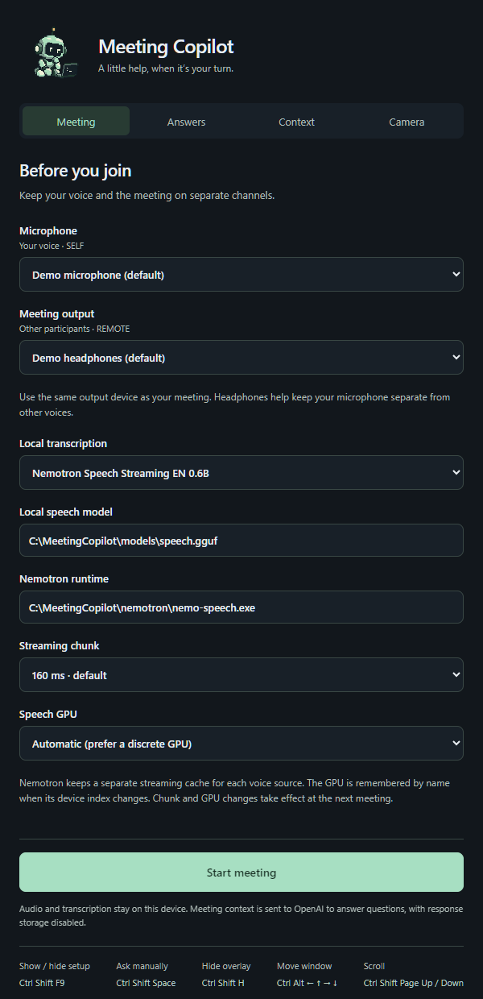
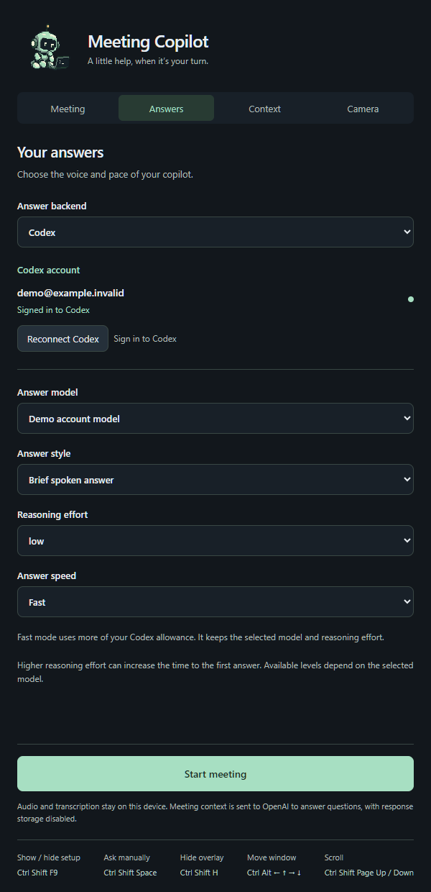
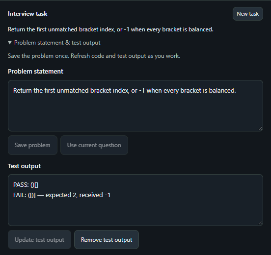

<p align="center">
  
</p>

<h1 align="center">Meeting Copilot</h1>

<p align="center">
  <strong>A little help, when it’s your turn.</strong><br>
  Bring the problem. Keep your train of thought.
</p>

<p align="center">Windows 10/11 · x64 · English transcription · Tauri + React</p>

<p align="center">
  <a href="#get-started">Get started</a> ·
  <a href="#keep-one-problem-together">Interview tasks</a> ·
  <a href="#keyboard-shortcuts">Shortcuts</a> ·
  <a href="#build-from-source">Build it</a> ·
  <a href="#troubleshooting">Need a hand?</a>
</p>

Meeting Copilot keeps your problem, saved code, screenshots, and follow-up questions at the same desk. It transcribes microphone and playback audio locally, then sends relevant text and explicitly shared context to OpenAI for suggested answers in a compact overlay.

| When you’re… | Your copilot can help you… |
| --- | --- |
| Starting a coding problem | Keep the statement and constraints nearby while you work. |
| Chasing a failing test | Bring saved code and the latest output into the same conversation. |
| Taking a follow-up | Focus on what changed, without another tour of the whole solution. |

### Take a quick look



*Save the problem → attach context → ask → read → start fresh.*

The 16-second walkthrough uses the real interface with synthetic data and a scripted sample answer; it is a workflow demo, not a speed measurement. Prefer a quiet page? Open the stills: [setup](docs/images/meeting-setup.png), [task editor](docs/images/interview-task.png), or [answer overlay](docs/images/answer-overlay.png).

> **Lost your copilot?** Press **Ctrl + Shift + F9** to bring setup back. Press it again to tuck setup away. **Ctrl + Shift + H** does the same for the answer overlay.

## Get started

### 1. Say hello to the desktop app

If you have a current installed build, open **mscv32** from its shortcut or run `mscv32.exe`. The window is titled **Meeting Copilot** and uses a gray cogwheel icon. It appears as **mscv32** in Task Manager. Setup and overlay windows have no taskbar buttons.

**Can't find the window? Press Ctrl + Shift + F9.** This shows and focuses hidden or minimized setup, and hides it when already visible. Opening the executable again brings the existing setup window forward. The overlay's **Setup** button also opens it.

If you cloned the repository, complete [Build from source](#build-from-source) first. `npm run dev` is a UI preview; audio capture, accounts, global shortcuts, and camera integration require the desktop app. The older local 0.2.2 MSI predates the current task and shortcut changes; see [package verification](docs/package-verification.md) for that build's scope.

### 2. Bring your answer account

Open **Answers** → set **Answer backend** to **Codex** → choose **Reconnect Codex** if already signed in, or **Sign in to Codex** to connect an account. Choose an **Answer model** from the account's available catalog.

Start with **Brief spoken answer**, **Low** reasoning effort, and **Fast** answer speed. Fast uses more of your Codex allowance. Model and effort availability depend on the connected account. **ChatGPT plan API** is an alternative backend with its own sign-in flow.

### 3. Let it hear the right voices

Open **Meeting** and set:

| Setting | What to choose |
| --- | --- |
| **Microphone · SELF** | The microphone carrying your voice. |
| **Meeting output · REMOTE** | The exact playback device used by your call. Headphones help keep the streams separate. |
| **Local transcription** | Nemotron Speech Streaming EN 0.6B. Whisper remains a legacy option. |
| **Local speech model** | The Nemotron English Q8 `.gguf` file prepared by setup. |
| **Nemotron runtime** | The prepared `nemo-speech.exe`. |
| **Streaming chunk** | Start with the default **160 ms**. |
| **Speech GPU** | Automatic, or a named device from the list. |

Paths normally populate from prepared workspace or bundled resources. If they are empty or outdated, check the model under `models/` and the runtime under `.local/nemotron/nemo-speech-0.2.0-windows-x86_64-vulkan/bin/` in a source checkout.

### 4. You’re ready—start and ask

Click **Start meeting**. Once the status becomes **Listening**, questions from the playback stream can trigger suggested answers. Use **Ctrl + Shift + Space** to open manual question input, or type into **Ask about this meeting…** in setup.

**Pause listening** pauses capture; **Resume listening** continues it. **Stop meeting** releases audio capture and clears the in-memory meeting content. Camera capture has its own **Stop camera** control.

All speech on the selected playback device counts as REMOTE, including other apps. The app separates microphone from playback; it does not identify individual remote speakers.

<details>
<summary><strong>A peek at setup: audio on one side, answers on the other</strong></summary>

<table>
<tr><th>Meeting: devices and local speech</th><th>Answers: account, model, and pace</th></tr>
<tr>
<td><a href="docs/images/meeting-setup.png"></a></td>
<td><a href="docs/images/answer-settings.png"></a></td>
</tr>
</table>

*Screenshots show the actual UI with synthetic devices, paths, and account data. Scroll inside the desktop window to reach settings below the fold.*

</details>

## Keep one problem together

One problem, one little workspace. Keep the statement steady while code, screenshots, and test results catch up with your thinking.

During a meeting, open **Context** in setup or use **Interview task** in the overlay.

1. Expand **Problem statement & test output**. Paste the requirements and constraints, then select **Save problem**. **Use current question** can save the current question instead.
2. Share the code or screen you want to discuss using the controls below. The problem stays attached across follow-ups.
3. Save code edits in your editor, then choose **Refresh project** to re-read the same folder. Paste the latest compiler or test results into **Test output**, then select **Update test output**.
4. Ask follow-up questions. Refreshing context re-answers the current question with the latest attachments. Without a current question, it uses the saved problem; without a saved problem, it provides a project overview or help with the visible screen.
5. Choose **New task** when moving to a different problem. It clears the problem, test output, project, screenshot, question, answer, and prior task conversation while keeping audio capture and its pause state. Pending context results from the old task are discarded.

**Dismiss answer** clears the displayed question and answer while keeping the task context. Use **Stop meeting** when the session is over.

### Simple code. Checked examples. Short follow-ups.

The coding instructions ask the AI to:

- **Find an efficient solution.** Optimize time and auxiliary space under your constraints, explain real trade-offs, and choose the simplest correct implementation.
- **Check before presenting.** Mentally trace examples and relevant edge cases, including empty input, duplicates, boundaries, and overflow. A mental check is not an executed test.
- **Keep follow-ups focused.** Explain only what changed and why. Show the necessary changed code; provide the full implementation when you ask for it or when the change needs it to be usable.

For example, after solving the bracket problem below, “What about an empty string?” should get a focused explanation of that case—not the whole algorithm again. These are answer instructions; keep running your actual tests.

<a href="docs/images/interview-task.png"></a>

### Share and refresh context

| Source | How to attach it | How to keep it current |
| --- | --- | --- |
| **Local project** | Before starting, choose a **Project folder** in Context. During the meeting, use **Send selected project**. | Save edits, then **Refresh project**. **Included files** lists the paths read. |
| **Active project / browser** | Focus VS Code, Explorer, or the browser, then press **Ctrl + Shift + P**. | Send again to detect the currently active view. Unresolved folders and browser views use a monitor screenshot. |
| **Screenshot** | Point at the desired monitor and press **Ctrl + Shift + F8**, or use **Send screenshot** / **Screenshot**. | **Retake screenshot** replaces the previous image. |
| **Test output** | Paste results into **Test output** and select **Update test output**. | Replace and update after each relevant run. |

Source labels show **Screenshot captured at…**, **saved files updated at…**, and **Test output updated at…** so older context is easy to spot. Unsaved editor buffers are not included. Use the individual **Remove** controls to detach sources.

Screenshots capture the **complete monitor under the pointer**. Active context detects local VS Code single-folder workspaces or Explorer folders; ambiguous or unresolved editors and browser views use a monitor screenshot. The explicitly chosen folder controls **Send selected project**; it does not override active-window detection.

## Keyboard shortcuts

Keep these three within reach: **F9** for setup, **H** for the overlay, **Space** to ask—each with **Ctrl + Shift** held down.

Global shortcuts work while the desktop app is running. If another app owns a shortcut, setup reports the conflict; use the corresponding on-screen control.

| Shortcut | Action |
| --- | --- |
| **Ctrl + Shift + F9** | Show / hide setup; restore it when minimized. |
| **Ctrl + Shift + H** | Show / hide the answer overlay. |
| **Ctrl + Shift + Space** | Open manual question input. |
| **Ctrl + Shift + F8** | Capture and send the monitor under the pointer. |
| **Ctrl + Shift + P** | Detect and send the active project or browser context. |
| **Ctrl + Shift + M** | Pause / resume audio capture. |
| **Ctrl + Shift + X** | Dismiss the current answer. |
| **Ctrl + Shift + E** | Request a longer answer. |
| **Ctrl + Shift + ↑ / ↓** | Scroll vertically in focused setup, or in the answer overlay. |
| **Ctrl + Shift + ← / →** | Scroll a visible code block horizontally. |
| **Ctrl + Shift + Page Up / Page Down** | Page through the reading surface. |
| **Ctrl + Shift + Home / End** | Jump to its top / bottom. |
| **Ctrl + Alt + Arrow keys** | Move focused setup, or the overlay, in 40-pixel steps. |

Drag the overlay by its status header. Automatic answers do not take focus; opening manual input does. Tab to a long question to scroll its full text with the reading shortcuts. Setup tabs are keyboard accessible, and decorative motion respects reduced-motion preferences.

## Optional camera / eye contact

Want to keep your notes nearby while looking toward the call? Camera correction is a separate, optional part of the app.

Open **Camera**, choose your input camera and device, then **Start camera preview**. Calibrate looking at the camera first, then looking at your notes. Select **OBS Virtual Camera** in your call; its driver must already be installed. Start around 10–12° correction; the maximum is 15°. **Stop camera** closes video and clears calibration.

See [camera verification and limitations](docs/camera-verification.md) and [gaze model details](docs/gaze-models.md) for tested configurations.

## Build from source

Prefer to make it yourself? Here’s the workbench.

Run commands in PowerShell from the repository root. Setup downloads dependencies, native runtimes, and model weights; allow time and disk space for these downloads and the initial Rust build.

**Prerequisites:** Windows x64, Git, Node.js 22+, Rust with the MSVC toolchain, Visual Studio C++ Build Tools with the Windows SDK, CMake, Python, `uv`, and Edge WebView2. Nemotron uses Vulkan; compatible GPU drivers are needed. Camera setup uses `uv` to prepare Python 3.11 environments.

```powershell
git clone https://github.com/aleksandarkolev-st/test-ts.git
cd test-ts

.\scripts\setup.ps1
.\scripts\setup-nemotron.ps1
.\scripts\setup-codex.ps1
.\scripts\setup-gaze.ps1
.\scripts\build-gaze.ps1

npm run desktop
```

The checked-in bundle configuration references camera resources too, so prepare them even if you plan to leave the camera off. Scripts keep downloaded assets and environments inside the workspace; weights and build outputs are ignored by Git.

| Script | What it prepares |
| --- | --- |
| `setup.ps1` | npm packages, Rust dependencies, local libclang, and the legacy tiny English Whisper model. |
| `setup-nemotron.ps1` | Pinned Windows Vulkan speech runtime and English Q8 model. `-RuntimeOnly` skips weights. |
| `setup-codex.ps1` | Pinned native Codex executable and license notices. |
| `setup-gaze.ps1` | Camera models, conversion checks, and local camera Python environments. |
| `build-gaze.ps1` | Standalone camera worker and dependency notices. |

Build an installer after preparing resources:

```powershell
npm run package
```

With the default Cargo target directory, the executable is `src-tauri/target/release/mscv32.exe` and the MSI is under `src-tauri/target/release/bundle/msi/`. `CARGO_TARGET_DIR` changes these locations. WiX is fetched by the Tauri bundler when needed. Keep bundled resources and native DLLs with the application; copying only the executable is not a portable installation.

For a standalone development build with the frontend embedded, without creating an installer:

```powershell
npx tauri build --debug --no-bundle --features tauri/custom-protocol
.\src-tauri\target\debug\mscv32.exe
```

`npm run desktop` uses Vite and should remain attached to its development process. `npm run build` only compiles the web frontend. CPU backends are selected at runtime; see [vendor changes](vendor/whisper-rs-sys/PATCHES.md).

## What stays local, and what is shared?

- **Audio:** microphone and playback transcription run locally. There is no audio-upload or recording library.
- **AI answers:** recent transcript, compact memory, and attached task context go to OpenAI as needed for answers and context compression. Codex uses ephemeral threads with history persistence disabled; the ChatGPT plan API requests `store:false`. These settings do not override service data policies.
- **Screenshots:** explicit captures are sent inline. The latest image stays in RAM for follow-ups until removed, replaced, a new task, or Stop. Image input requires a compatible model.
- **Projects:** explicit sharing sends readable saved text. Collection respects ignore rules and excludes generated folders, repository metadata, and common credential files. Binary files, non-UTF-8 files, and symbolic links are skipped and listed. Limits are **2 MiB per file**, **4 MiB total text**, and **4,000 scanned files**; exceeding a limit fails the attachment. A service may impose a smaller context limit.
- **Storage:** task content stays in RAM. SQLite stores settings, host/account IDs, and meeting start/end metadata; only an explicitly chosen folder path is saved, not project content. Codex manages its credentials; the alternative backend uses Windows Credential Manager. Logs contain numeric latency metrics, not meeting text.
- **Share protection:** the status reports whether Windows capture exclusion was applied and verified. Hiding the window or seeing **Share protection active** does not guarantee exclusion from every capture app. See [capture verification](docs/verification.md).

## Troubleshooting

Small snag? Start here.

| Symptom | What to check |
| --- | --- |
| App is running but invisible | Press **Ctrl + Shift + F9** or open its shortcut/executable again. Setup has no taskbar button. |
| **Start meeting** is disabled | Connect an account, choose a model and audio devices, and provide speech model/runtime paths. |
| No remote speech appears | Make your call use the same **Meeting output** device selected in the app. Resume if paused. |
| Speech runtime or model is missing | Run `setup-nemotron.ps1` and check the `.gguf` and `nemo-speech.exe` paths in Meeting. |
| Answer models do not load | Check the backend, reconnect/sign in, and select from that account's catalog. |
| Code context is out of date | Save files, then **Refresh project**. Check included paths and update time. |
| Wrong folder or screen was sent | Select a project explicitly, or point at the intended monitor before capturing. Remove the previous attachment. |
| Context is too large | Choose a smaller relevant folder or remove attachments. Local collection and model limits are separate. |
| Shortcut does nothing | Check setup's conflict message and use the on-screen control. F9 controls setup; H controls the overlay. |
| Camera preview/output is unavailable | Prepare camera resources, confirm the input device, and install OBS Virtual Camera's driver for virtual output. |

## Development and evidence

Under the hood, useful answers still need honest measurements and working tests.

```powershell
npm test
npm run test:e2e
cargo test --manifest-path src-tauri/Cargo.toml --lib
```

See [testing and native acceptance](docs/testing.md) for real-audio, credential, soak, and live-service checks. Browser fixtures check UI behavior; they do not establish live meeting accuracy. Live response times vary; the near-instant latency target remains unmet in collected evidence.

- [Runtime design and historical latency measurements](docs/runtime-notes.md)
- [Adaptive interview evaluation](docs/adaptive-interview.md)
- [Verification ledger](docs/verification.md)
- [Remaining upgrade work](docs/upgrade-plan.md)
- [README media and how to regenerate it](docs/images/README.md)

## License

MIT. Third-party source and model assets retain their own licenses; see [third-party notices](THIRD_PARTY_NOTICES.md) and [bundled notices](THIRD_PARTY_NOTICES.txt). whisper.cpp and GGML are MIT; whisper-rs-sys is Unlicense. The legacy Whisper model comes from [ggerganov/whisper.cpp](https://huggingface.co/ggerganov/whisper.cpp), based on OpenAI Whisper.
